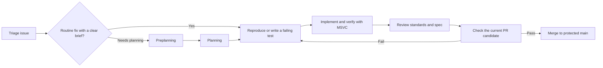

# Ground-up development workflow for Empire at War Vulkan

Design proposal · November 21, 2026

Build the new repository around small, independently verifiable changes. Claude Code and Codex use the same project skills, issue briefs, tests, and build commands. MSVC builds every native C++ target from the first local check through the shipped Windows package. A change carries its evidence from the first failing example to the pull request and, when needed, through release and incident recovery. [New Empire at War Vulkan repository](https://github.com/Gabriel-Barney/Empire-at-war-Vulkan)

The aim is to shorten the time from a clear idea to a working change while reducing broken builds, wrong implementations, flaky checks, lost work, and release regressions. A deliberately failing regression test is useful feedback. The failures to drive down are avoidable rework, inconclusive checks, and defects that escape the gate.

## Design decisions

| Decision | What it changes |
| --- | --- |
| One GitHub issue owns the outcome. | The brief carries acceptance examples, blockers, risk, and a test seam. When a change needs both planning passes, the same issue records the findings and first implementation slice. A fresh session can resume from the issue, PR, and branch without reconstructing a chat or renewing a claim. |
| One maintainer-facing workflow works in either agent. | Matt Pocock’s skills define how to clarify, design, test, diagnose, and review. Project scripts make the checks repeatable for either agent and for humans. |
| One C++ compiler and one build interface. | The CMake target graph, pinned MSVC toolchain, and shared presets drive local checks, CI, and packaging. Target selection includes transitive dependencies. |
| One protected integration branch. | Small PRs land on `main` after evidence passes for the current integration candidate. Releases come from identified commits and tags. |
| Parallelism follows dependencies and machine capacity. | Independent issues can run concurrently. Shared interfaces have a named owner for each change, and local jobs request capacity before running. |

The old repo recorded 5,066 builds across 99 worktrees over 23 days. It recorded 1,669 failures, including local iteration, and 227 of 1,770 commits in the measured history touched stored derived goldens. It also documented timeouts under concurrent test load, a local verifier found deleted with work waiting, and a roadmap with expired claims and more started work than its stated limit. These are specific failure modes for the new design to exercise during rollout. [Workflow baseline](https://github.com/Gabriel-Barney/Empire-at-war-vulkan-old/blob/7f911b51/docs/PERFORMANCE.md#L1481-L1511) · [Concurrent tests](https://github.com/Gabriel-Barney/Empire-at-war-vulkan-old/blob/7f911b51/docs/BUILD.md#L37-L48) · [Verifier decision](https://github.com/Gabriel-Barney/Empire-at-war-vulkan-old/blob/7f911b51/docs/DECISIONS.md#L544-L546) · [Roadmap audit](https://github.com/Gabriel-Barney/Empire-at-war-vulkan-old/blob/7f911b51/docs/ROADMAP_AUDIT_2026-11-19.md#L17-L27)

## The skills define the workflow

Matt Pocock’s collection addresses three different sources of rework. `grill-with-docs` and `domain-modeling` clarify behaviour and shared terms before implementation. `tdd` and `diagnosing-bugs` turn guesses into executable feedback. `codebase-design` and the two-axis `code-review` keep module interfaces and implementation aligned with the brief. Those practices form the default path below. The project adaptations account for MSVC, Windows, game fixtures, and the permissions of each client. [skills.sh catalog](https://www.skills.sh/mattpocock/skills) · [Reviewed upstream revision](https://github.com/mattpocock/skills/tree/abeeaf95660ba9e8b7c753eb38f441ca707a8823)

| Situation | Upstream skills and repository integration | Evidence that lets work advance |
| --- | --- | --- |
| Configure the repo once | `setup-matt-pocock-skills` supplies the tracker, triage roles, and domain-doc conventions. Bootstrap records GitHub Issues in `docs/agents/issue-tracker.md`, the label mapping in `docs/agents/triage-labels.md`, and the glossary location in `docs/agents/domain.md`. Decisions stay in `docs/DECISIONS.md`. | Both clients can locate the tracker and domain docs from a fresh checkout. |
| Triage a request | `triage` checks duplicates, scope, and evidence. Use its two categories and five readiness states. Keep the assignee and linked PR as the execution state. | One issue with a reproducible defect or an observable outcome. Missing facts become one specific question. |
| Preplanning | Read the repo first. Use `grill-with-docs`, `grilling`, and `domain-modeling` for ambiguous behaviour, `research` for primary-source questions, `prototype` for behaviour that needs to be tried, and `wayfinder` for unresolved decisions across sessions. | Findings, affected contracts, and any decision blocking the change. |
| Planning | Use `to-spec` to capture agreed behaviour and test seams. Use `codebase-design` for a changing interface and `to-tickets` to split larger work into vertical slices with explicit dependencies. | The first independently verifiable slice, its acceptance evidence, and the MSVC checks needed to verify it. |
| Implement one slice | `implement` runs `tdd` at an agreed public seam. Use `codebase-design` when changing a boundary so tests exercise behaviour through a small interface. Replace generic typecheck and test instructions with the MSVC commands below. | A test fails for the intended reason, then passes with the smallest working implementation. The affected MSVC targets and tests pass. |
| Debug or recover | `diagnosing-bugs` starts with a repeatable failure, then minimizes the case, tests a hypothesis, and verifies the fix. Prefer a headless replay, fixture, or focused CTest case. For build failures, start with the first causal configure, compiler, or linker diagnostic. | A reproduction command, a verified cause or narrowed hypothesis, and a regression check for the fix. Infra failures stay associated with their run and environment. |
| Review and land | `code-review` performs independent **Standards** and **Spec** passes on a fixed diff. Use two read-only contexts where available and permitted, or run two separate passes locally. `pr` records the outcome, evidence, and merge risk. | Review identifies concrete defects and missing acceptance evidence. A current CI run supplies the mechanical verdict. |
| Pause or improve the system | `handoff` provides a concise resume note, adapted to put durable facts on the existing issue or draft PR when authorized. `retro` looks for repeated friction. `improve-codebase-architecture` surfaces small, evidence-backed interface improvements. `writing-for-agents` keeps instructions short and tied to discoverable commands. | A second agent can resume, and a recurring failure has an owner and a specific preventive change. |

### Planning

After triage, a routine fix with clear expected behaviour, a known reproduction or existing test seam, and no unresolved dependency can use its issue brief as the plan. Go straight to diagnosis or TDD. Use both passes when behaviour or impact is unclear, work spans dependent slices, or the change affects a shared API, simulation contract, save format, build gate, or release procedure. Record both passes on the issue so either client can pick up the work.

1. **Preplanning.** Inspect the current code, tests, fixtures, glossary, and relevant decisions. Identify affected contracts, dependencies, and assumptions that could change scope, compatibility, or verification. Resolve what the repo can answer and bring unresolved product or contract decisions to the maintainer. Use a focused reproduction, research, or scratch prototype when it can settle an uncertainty. Record what was learned and flag any blocker that must be resolved before the slice can start. `to-spec` and `to-tickets` do this first, as a `## Preplanning` comment on the issue (`docs/agents/preplanning.md`). Update `GLOSSARY.md` when a term changes and add a `docs/DECISIONS.md` section for a durable, consequential trade-off (`docs/DECISIONS.md` "Decisions live in DECISIONS.md").
2. **Planning.** Use the findings to name the first independently verifiable slice, its expected outcome, and the public interface, headless scenario, or fixture used to check it. Record the first command to run or the first failing test to write, the affected MSVC targets and presets, and the evidence expected on the PR. Include compatibility and rollback expectations when relevant. An established test seam can come from the brief or repository policy. Confirm a new seam when it changes what the project promises to verify. For larger work, link the dependent slices and start with one whose prerequisites are satisfied.

A slice is ready when a fresh Claude Code or Codex session can read the issue, identify the first concrete action, and tell which result satisfies the acceptance criteria. If implementation exposes a new blocker or invalidates an assumption, update the affected part of the same issue before proceeding.

For a save-format change, preplanning identifies the oldest supported save version, a representative fixture, and what an older executable should do with a new save. The plan starts with a failing load test for that fixture, names the MSVC target and preset, and records which compatibility and rollback results the PR needs.

Upstream `implement-spec` assumes a worktree and implementer per ticket, followed by merges onto a separate integration branch. Use its dependency-graph practice through `to-tickets` and the normal per-slice PR path. The dependency graph determines when to start work. Each slice owns its own integration and verification. The public catalog also has writing, teaching, language-specific setup, and overlapping orchestration skills. Keep these available for individual use outside the repository’s default workflow. [Upstream workflow reference](https://github.com/mattpocock/skills/blob/abeeaf95660ba9e8b7c753eb38f441ca707a8823/README.md#reference) · [Upstream implement-spec](https://github.com/mattpocock/skills/blob/abeeaf95660ba9e8b7c753eb38f441ca707a8823/skills/engineering/implement-spec/SKILL.md)

### One skill source for Claude Code and Codex

- **Pin and adapt.** Keep the selected skill sources, supporting files, upstream revision, and MIT notice under `workflow/skills/`. Give each project skill an `eaw-` name so personal and marketplace copies can coexist. The manifest records the upstream path, revision, local adaptations, and invocation policy. Updates arrive as ordinary PRs with a source diff and the two-client smoke checks. [Upstream license](https://github.com/mattpocock/skills/blob/abeeaf95660ba9e8b7c753eb38f441ca707a8823/LICENSE)
- **Generate the two client folders.** Check in complete, generated skill folders under `.claude/skills/` and `.agents/skills/`, including their relative references. Use ordinary files so a Windows clone needs no symlinks. Generate Claude’s `disable-model-invocation` and Codex’s `agents/openai.yaml` policy from the same manifest. For example, `/eaw-implement` in Claude Code and `$eaw-implement` in Codex CLI select the same workflow. On setup, check for discovery and name collisions in each client actually used. [Claude Code skills](https://code.claude.com/docs/en/skills) · [Codex local skills and invocation policy](https://learn.chatgpt.com/docs/build-skills)
- **Keep orchestration explicit.** Setup, triage, specification and ticket creation, multi-session planning, implementation entry, and retrospectives are user-invoked. Supporting skills such as TDD, diagnosis, design, and review can activate when the selected task calls for them. Keep shared repository policy in `AGENTS.md`, with Claude’s `CLAUDE.md` importing it and pointing to the same tracker and domain docs. Use an available tracker connector or `gh` and fall back to separate local review passes when separate read-only agents are unavailable. Apply the client’s permissions for posting, editing, and launching agents. [Claude Code project instructions](https://code.claude.com/docs/en/memory)
- **Test the integration as code.** CI regenerates and compares both trees, parses metadata, checks internal references, and rejects duplicate project skill names. The acceptance test runs a sample issue in Claude Code: it must find the brief, use the expected skill, call the expected MSVC command, and produce the expected shape of PR evidence. The Codex folder is generated and checked the same way but not acceptance-tested until Codex is in use (`docs/DECISIONS.md` "Codex skills are generated, not acceptance-tested"). New clones load the shipped files without downloading a mutable skill pack.

## Work intake and ownership

The issue brief states the outcome, one or two observable acceptance examples, the test seam or manual evidence, blockers, and risk. An assignee owns the next action. The code, branch, and last checked SHA live on the linked PR. Capture the last passing or failing command and the next step before switching clients. A Windows temp handoff can carry private session notes locally. Share only the durable, sanitized facts needed to resume work.

Parallel work starts when slices have independent interfaces, fixtures, or consumers and the available runners can serve them. Keep one writer per checkout and one owner of a shared boundary during a change. Reuse a warm checkout when idle. Make a separate checkout for genuinely concurrent work or an isolated reproduction, with its own build and output directories. Use a machine-wide resource budget for local build jobs and tests, with smaller CTest pools for scarce resources. If capacity is exhausted, show what is waiting and why. Let process-owned capacity release when a process exits. Preserve unique commits and edits before cleaning up a checkout.

## MSVC build and verification

Use `cl.exe` and `link.exe` for C++, with an explicit Visual Studio Build Tools toolset, Windows SDK, architecture, CMake version, generator, and dependency lock. The development command checks the actual compiler and link configuration before building. Start with x64 Windows and build directories isolated by checkout and preset. Bootstrap checks prerequisites, restores pinned dependencies, and runs a synthetic smoke test using repository fixtures. Set warnings for project-owned code with `/W4` and enforce the agreed warning policy with `/WX` where clean, using explicit, scoped exceptions for imported code. [MSVC warning controls](https://learn.microsoft.com/en-us/cpp/build/reference/compiler-option-warning-level) · [CMake presets](https://cmake.org/cmake/help/v4.1/manual/cmake-presets.7.html)

Expose one entry point, `dev.cmd` at the repository root, with a small set of commands. `dev.cmd` is a thin shim: it checks that the toolchain's Python exists, prints the remediation if it does not, and passes every argument unchanged to `tools/dev.py`, which holds the logic and shares code with `tools/test_suite.py` and the gate checks. Every caller (cmd, PowerShell, Git Bash, CI, Claude Code, Codex) runs the same command, with no execution-policy setup. See `docs/DECISIONS.md` "One development entry point". The entry point invokes CMake and CTest with explicit argument lists, propagates exit codes, checks target names before configure, and leaves the build graph responsible for target dependencies. Reports contain the failing step, first meaningful diagnostic, toolchain and source identity, reproduction command, elapsed time, and a full log path. CI adds JUnit output. Cache restored dependencies and measured compiler artifacts with exact toolchain and input keys. Keep a clean-build path available to diagnose cache drift. [CTest reference](https://cmake.org/cmake/help/v4.1/manual/ctest.1.html)

| Proposed command | What it does |
| --- | --- |
| `dev.cmd doctor` | Reports the selected toolchain, SDK, dependency state, and missing prerequisites with remediation. |
| `dev.cmd check --preset fast` | Builds and runs the fast suite. An optional target focuses local iteration. Shared headers, build changes, and ambiguous impact expand coverage. |
| `dev.cmd check --preset full` | Builds a clean MSVC configuration and runs all hostable tests, including slow scenarios and the applicable Debug and Release checks. |
| `dev.cmd check --preset analyze` or `--preset asan` | Runs MSVC `/analyze` or compile-and-link `/fsanitize=address` in a distinct build directory. CI records what is covered and requires the relevant check for high-risk changes once the preset is proven. |
| `dev.cmd package --commit <sha>` | Builds or verifies the package for a named commit, stages it outside the checkout, and emits checksums and a manifest. |

Remove Clang, clang-cl, clangd, Clang lint hooks, cross-compiler comparison, and Clang-based sanitizer jobs from the new project’s build and support paths. Use MSVC analysis, an ASan preset with incompatible MSVC flags disabled, Debug and optimized Release runs, and targeted integer, lifetime, concurrency, and determinism tests. ASan covers memory errors in its supported configurations. Compiler portability falls outside the guarantee, and detection of undefined behaviour and races depends on the specific MSVC checks, tests, and review. Use repeatable worker-count stress and deterministic replays for concurrency. [MSVC code analysis](https://learn.microsoft.com/en-us/cpp/build/reference/analyze-code-analysis) · [MSVC AddressSanitizer limits](https://learn.microsoft.com/en-us/cpp/sanitizers/asan-known-issues)

## Evidence and integration

Run a stable required `landing` status for every PR into `main`. The workflow records the PR head, base, and tested merge candidate. Use a GitHub-hosted Windows runner for public PR code with read-only access. Block direct pushes through the PR requirement, land PRs squashed with linear history, and bind the expected check to GitHub Actions. A PR does not need to be up to date with `main`; the `landing` run on each push to `main` rechecks the combined result (`docs/DECISIONS.md` "Pull requests land squashed without an up-to-date rule"). Authors with write access can use auto-merge for routine PRs. Release publication and durable contract changes have a named maintainer decision. [GitHub rulesets](https://docs.github.com/en/repositories/configuring-branches-and-merges-in-your-repository/managing-rulesets/available-rules-for-rulesets) · [PR merge candidate semantics](https://docs.github.com/en/actions/reference/workflows-and-actions/events-that-trigger-workflows#pull_request) · [Actions secure use](https://docs.github.com/en/actions/reference/security/secure-use)

| Change | Evidence required for landing |
| --- | --- |
| Documentation only | Validate links, Markdown, or changed skill metadata where applicable. Use explicit path classification. A classification error fails the gate. |
| Routine code or fixtures | MSVC build, fast CTest suite, checks for the changed feature, and Spec and Standards review. The build graph selects affected targets. Unknown impact uses broader coverage. |
| Simulation, persistence, or threading contract | Add deterministic replays, representative worker counts, backward save or data compatibility tests where relevant, and targeted MSVC analysis or ASan. Capture who accepted changes to the contract. |
| Build, workflow, or dependency configuration | Clean Windows configure and build, smoke tests, and gate self-tests that verify skipped, failed, stale, and cancelled evidence fails closed. Require maintainer review of changes to the checks themselves. |
| GPU, installed game data, or private mods | Run `dev.cmd suite retail`, `vulkan` or `traces` (or a playtest) on the maintainer's Windows machine at the tested candidate or release SHA. Record the commit, scope, environment, and outcome on the PR. No self-hosted runner executes PR code, and private inputs stay outside public PR CI (`docs/DECISIONS.md` "Retail and GPU evidence is a recorded local run"). |

Measure the default PR check before adding broader required coverage. Cancel superseded runs by PR so they release capacity. The aggregate status succeeds only after the selected required jobs report valid success for that candidate. Docs-only jobs take an explicit lightweight path. An unavailable runner, failed setup, missing required scenario, or empty test selection leaves the PR pending or failed with a reason. Nightly runs cover expensive MSVC checks and produce a dated last-passing SHA. A missed run has an on-demand recovery path. A slow check that is essential to a specific change runs before that change ships.

### Simulation and content

Keep test inputs, scenario definitions, seeds, and intentional invariants in Git. Keep generated traces and CRC streams with the run. Use the same pinned toolchain and fixture inputs for base and candidate, and check repeatability before interpreting their differences. For a simulation PR (a change to a path in `tests/simulation_paths.txt`), its description carries `Behaviour: none` or declares the affected scenarios and systems with a `Behaviour:` line (`docs/DECISIONS.md` "Simulation changes are declared"). The accompanying test records the expected observable effect. CI records the immutable head SHA, fails a simulation PR without the declaration, and runs the targeted assertion on the candidate. An unrelated difference fails. If a test harness changes, verify it against the base with a compatible fixture or record the baseline migration and revalidate the invariant independently. Cover supported mods and saves with representative inputs and explicit compatibility expectations.

For example, a change to the order in which simultaneous combat events resolve starts with an issue that states the intended tie-break and a test at the headless battle seam. Record the failing case on the old behaviour, fix it, and run the same seed across selected worker counts. The PR links the first relevant tick, expected outcome, and scenario result. A changed save format or worker-count divergence would require its own evidence.

## Failure response and release

| Failure | First response | Prevention or recovery |
| --- | --- | --- |
| Missing SDK, dependencies, cache mismatch, configure failure | Run `doctor` and reproduce the failing configure with its toolchain identity. | Fix bootstrap, invalidate the relevant cache key, or tighten the dependency or target check. |
| Wrong implementation or build/test failure | Reproduce the same issue or command and verify a specific cause before changing code. | Add an acceptance example or regression case at the seam that exposed the defect. |
| Flake, resource timeout, or CI outage | Preserve the first result and distinguish a product failure from an infra error. Use an authorized isolated rerun for infra. | Quarantine only a known non-critical flake with a tracking issue, owner, and expiry. Determinism and safety-critical cases fail on the first product failure. Resume CI checks on the current candidate when service returns. |
| Regression on `main` or in a released package | Record the failing revision, last known good revision, evidence, and impact. Bisect when intermediate revisions can run the same check. | Land a tested fix or revert through a PR. For a released regression, retain the previous known-good package and publish a verified replacement after testing recovery and compatibility. |

Build the release candidate from a named commit on a trusted runner. Record commit, toolchain, dependencies, artifact hashes, and test evidence in the release manifest. Smoke-test the exact package on a clean Windows environment, including launch, install paths, and a basic gameplay or headless run. Include additional save, GPU, and mod coverage according to the release scope. Publish that package from its tag with notices and checksums after maintainer sign-off. Validate rollback against save compatibility before advising users to downgrade.

## Rollout and measures of success

| Order | Deliverable | Proof |
| --- | --- | --- |
| 1 | Scaffold the new repo, MSVC presets, synthetic headless smoke test, and Windows `doctor`. | A fresh Windows machine and hosted runner build the same target and run the same test. Wrong compiler, missing SDK, and wrong target inputs fail early with a usable diagnosis. |
| 2 | Pin the skill pack, generate both client folders, and configure issue briefs, planning, and PR evidence. | Run a routine fix directly from its brief in Claude Code, through red, green, review, and a prepared PR. |
| 3 | Enable protection, risk-based checks, deterministic comparisons, and artifact reports. | Inject a compile failure, a wrong result, an undeclared simulation change, and a missing required CI result. Each fails at the intended point. In a two-PR race, the second needs current-base evidence. Two concurrent local test jobs respect capacity without timing each other out. |
| 4 | Exercise recovery, package an internal release, and start porting by vertical slice. | Demonstrate a dropped runner, a flaky check, a revert, and an exact-package smoke test. Import active items and fixtures with old issue or roadmap identifiers and source commits. |

For the first 20 routine PRs and the first two release exercises, establish a baseline by risk and change type. Track median time from first commit to merge, P90 from push to a usable gate result including queue time, reruns per PR by cause, escaped defects and reverts per merged PR, and recovery time from a reproduced regression to a verified fix. Track release regressions separately from development regressions. Record intentional TDD failures separately from integration failures. Report counts alongside rates when sample sizes are small. These are repository measures adapted from DORA’s delivery and instability concepts. [DORA metrics](https://dora.dev/insights/dora-metrics-history/)

Start with pilot targets of **P90 under two minutes for a warm targeted check** and **P90 under ten minutes for a routine hosted PR result**. Aim for zero stale or incomplete candidates accepted and zero undeclared simulation changes in the pilot. Compare lead time and escaped defects together before changing the gate. If integration retries dominate, revisit merge scheduling. If local timeouts dominate, tune the machine budget. If wrong implementations dominate, improve acceptance examples and test seams. Revisit one measured bottleneck at a time.
